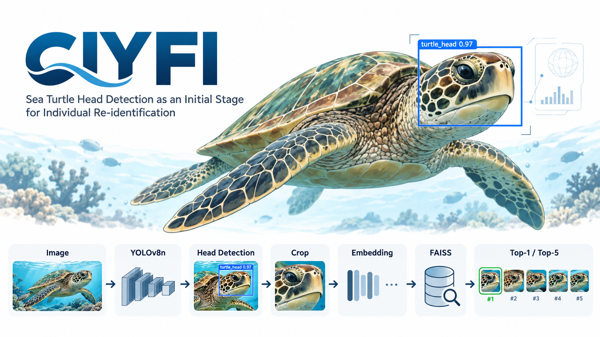

# CIYFI Examples

This directory contains visual and technical examples associated with the CIYFI project.

## Pipeline overview

The conceptual CIYFI workflow is:

Image
→ YOLOv8n
→ Head detection
→ Head crop
→ Embedding
→ FAISS
→ Top-1 / Top-5

## Important

The main validated result of the current research corresponds to sea turtle head detection using YOLOv8n.

The embedding, FAISS and Top-1 / Top-5 stages represent the experimental re-identification pipeline and future development of the project.

## Detector model

The trained detector is available at:

../models/best.pt
